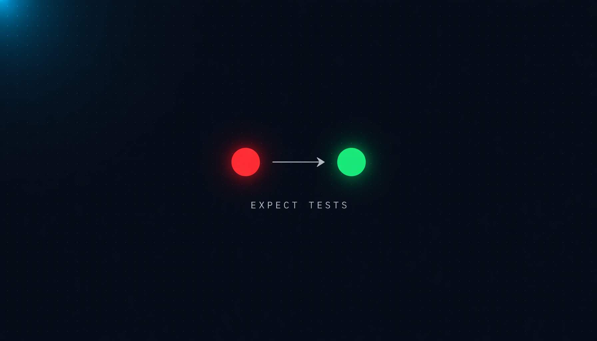

<p align="center">
  
</p>

# haz-test

[English](#english) · [Español](#español)

---

## English

An agent skill for writing tests that are worth it.

### What it solves

Traditional tests copy the logic: they rewrite the calculation, mock everything and assert
internals. When the code changes, the test breaks without any business rule breaking; and when
a real rule (money, permissions, data) breaks, the test never notices. This skill flips it:
tests assert the outcome the user sees, run the real code and stub only external edges. If a
business rule breaks, the test goes red. If you refactor, it stays green.

### Why use it

- **Fewer tokens** — the agent reads one short skill and writes only tests for real rules,
  instead of hundreds of trivial ones.
- **Less time** — every fix leaves a test that fails without it, so the bug does not return
  weeks later with different wording.
- **Fewer incidents** — expensive paths (money, permissions, user data) stay covered, and
  refactors stop breaking tests that verified nothing.

In the repo where it was born: ~800 assertions, 93 test files, the full suite in 70 s with no
network.

### How it works

1. **Reads the project first** — detects the runner, the test layout and whether tests assert
   visible outcomes. If it already tests this way, it follows it; if not, it adds the minimum
   without changing behavior.
2. **Lists the invariants** — the rules that must never break.
3. **Writes expect tests** — "given X, expect Y", real code, stubs only at the edges.
4. **Proves red → green** — every fix ships its regression test.

Full detail in [SKILL.md](SKILL.md).

### Install

Tell your agent this. It knows where its harness stores skills.

```text
Copy the skill from https://github.com/palomo1632-prog/haz-test into my skills directory
as `haz-test` and use it to write this project's tests. Confirm when installed, then
follow the skill from step 0.
```

Works in Qoder, Claude Code, Codex, OpenCode, DSH, Pi, Copilot and any agent that reads
`SKILL.md`. If your agent cannot download repos, paste the contents of [SKILL.md](SKILL.md) and
ask it to save it as `haz-test/SKILL.md`.

Then use it with `/haz-test` or just say "write tests".

### Sources

- **Luke Parker** ([@LukeParkerDev](https://x.com/LukeParkerDev)) — the post that started the
  discussion: *"i deleted all the tests in my repo and banned them in AGENTS.md… tests were
  always just a second, worse copy of your logic."*
- **lauren** ([@poteto](https://x.com/poteto), grok @bot at SpaceXSI) — reply:
  *"you're right / i like expect tests."*
  ([post](https://x.com/poteto/status/2122940539612098627))
- **lauren** — what expect tests are: *"just print stuff out and capture it in the test. makes
  behavior legible. it's very similar to how compilers have fixture tests"*, used rigorously on
  React Compiler. ([post](https://x.com/poteto/status/2114630175040348590))

**Stance** — Luke is right that a test that copies the logic is waste. The answer is not
dropping tests: it is asserting the visible outcome, which is what lauren calls expect tests.

---

## Español

Una skill de agente para escribir tests que valen la pena.

### Qué soluciona

El test tradicional copia la lógica: escribe de nuevo el cálculo, simula todo y afirma cosas
internas. Cuando el código cambia, el test se rompe sin que nada del negocio se haya roto; y
cuando una regla real (plata, permisos, datos) se rompe, el test no se entera. Esta skill
invierte eso: el test afirma el resultado que ve el usuario, ejecuta el código real y solo simula
lo externo. Si una regla de negocio se rompe, el test se pone rojo. Si refactorizás, sigue verde.

### Motivos para usarla

- **Menos tokens** — el agente lee una skill corta y escribe solo tests de reglas reales, no
  cientos de tests de código trivial.
- **Menos tiempo** — cada arreglo deja un test que falla sin el fix: el bug no vuelve semanas
  después con otra redacción.
- **Menos problemas** — los caminos caros (plata, permisos, datos) quedan cubiertos y los
  refactors dejan de romper tests que no verificaban nada.

En el repo donde nació: ~800 comprobaciones, 93 archivos, la suite completa en 70 s y sin red.

### Cómo funciona

1. **Lee el proyecto primero** — detecta runner, carpetas y estilo. Si ya testea así, lo respeta;
   si no, implementa lo mínimo sin cambiar comportamiento.
2. **Lista las invariantes** — las reglas que nunca se pueden romper.
3. **Escribe expect tests** — "dado X, espero Y", código real, dobles solo en los bordes.
4. **Demuestra el rojo → verde** — todo arreglo trae su test de regresión.

Detalle completo en [SKILL.md](SKILL.md).

### Instalación

Decile esto a tu agente. Él sabe dónde van las skills de su harness.

```text
Copiá la skill de https://github.com/palomo1632-prog/haz-test en mi directorio de skills
como `haz-test` y usala para escribir los tests de este proyecto. Confirmame cuando esté
instalada y seguí la skill desde el paso 0.
```

Sirve en Qoder, Claude Code, Codex, OpenCode, DSH, Pi, Copilot y cualquier agente que lea
`SKILL.md`. Si tu agente no puede descargar repos, pegale el contenido de [SKILL.md](SKILL.md) y
pedile que lo guarde como `haz-test/SKILL.md`.

Después se usa con `/haz-test` o simplemente pidiendo "haz test".

### Fuentes

- **Luke Parker** ([@LukeParkerDev](https://x.com/LukeParkerDev)) — el post que abrió la
  discusión: *"i deleted all the tests in my repo and banned them in AGENTS.md… tests were
  always just a second, worse copy of your logic."*
- **lauren** ([@poteto](https://x.com/poteto), grok @bot at SpaceXSI) — respuesta:
  *"you're right / i like expect tests."*
  ([post](https://x.com/poteto/status/2122940539612098627))
- **lauren** — qué son los expect tests: *"just print stuff out and capture it in the test.
  makes behavior legible. it's very similar to how compilers have fixture tests"*, usados a
  fondo en React Compiler. ([post](https://x.com/poteto/status/2114630175040348590))

**Postura** — Luke tiene razón en una cosa: un test que copia la lógica es gasto. Pero la
respuesta no es quedarse sin tests, sino que el test afirme el resultado visible. Eso es
exactamente lo que lauren llama expect tests.

---

## License / Licencia

MIT
